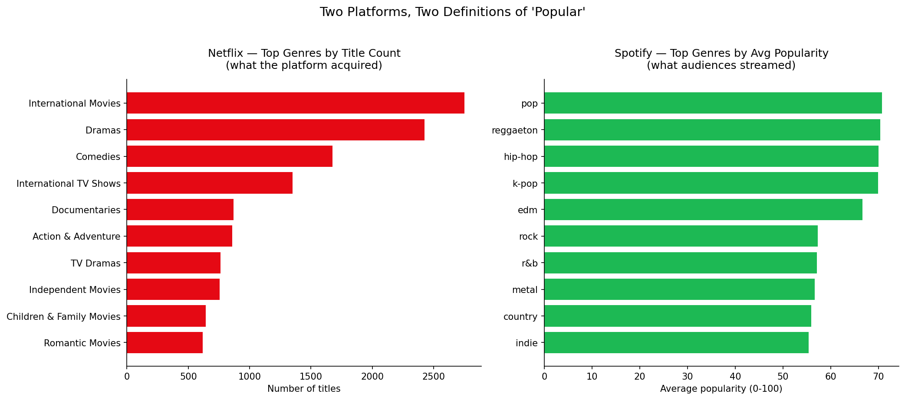

# Content Platforms Comparison — Netflix vs Spotify

> Two consumer platforms, two completely different ways of defining "what works."
> A synthesis of [netflix-analytics](https://github.com/Mallika56/netflix-analytics) and
> [spotify-analytics](https://github.com/Mallika56/spotify-analytics).

**Skill demonstrated:** Cross-project synthesis — reading two different datasets together to surface what neither shows alone.

---

## The Question

Both Netflix and Spotify are content-driven consumer platforms. Both publish data that
analysts use to describe "popular" content. But the *kind* of data each provides is
fundamentally different — and that difference, more than any single finding from either
project alone, is the most useful thing to notice.

This writeup compares the two platforms not by their raw values (the units don't align),
but by what their data *reveals* about how they operate.

## The Central Chart



These two rankings look structurally identical — bar charts of top genres. But the left
panel measures **what Netflix chose to acquire**; the right panel measures **what Spotify
audiences chose to stream**. Same word ("popular"), different mechanism. The visual
juxtaposition is the central point of this whole comparison.

---

## What "Success" Even Means

The single most important difference between the two datasets is what their metrics
actually capture.

**Netflix's data is supply-side.** Every row is a title the platform decided to license or
produce. The genre counts, country breakdowns, and rating distributions all describe
*Netflix's choices*, not audience response. There is no view-count column, no watch-time
field — engagement on the platform is fundamentally absent from public data. So when the
Netflix analysis surfaces "International Movies is the #1 genre," what it's really saying
is *Netflix chose to acquire more international content than anything else*. That's a
strategy finding, not a popularity finding.

**Spotify's data is demand-side.** The `popularity` score (0–100, recency-weighted) is
literally a measure of audience attention. Genre averages, audio-feature correlations, and
distribution shapes all describe *what listeners gravitate toward*, often in spite of
what's catalogued. When the Spotify analysis surfaces "danceability correlates with
popularity (r = 0.43)," it's saying that *audiences reward danceable music*, regardless of
the platform's curation.

So the word "popular" carries opposite meanings across the two projects. On Netflix it
means **"the platform bet on it."** On Spotify it means **"listeners came back to it."**
Conflating these is one of the most common mistakes in casual platform analysis.

## Curation vs Scale

Netflix's catalog is around 8,800 titles — each one a deliberate acquisition. Spotify's
catalog runs into the tens of millions of tracks with effectively no curation gate.

That difference shows up directly in the analyses. Netflix's *catalog* skews systematically
— toward international content (2,752 of 8,807 titles are tagged "International Movies"),
toward mature ratings (TV-MA dominates at 3,207 titles, more than family ratings combined),
and toward movies over TV (70/30 split). These are *choices*, not accidents.

Spotify's *popularity*, on the other hand, skews toward audio characteristics — danceable,
energetic, vocal — that cluster in a handful of genres (pop, hip-hop, reggaeton, k-pop all
average 70+ in popularity). These genres aren't winning because the platform pushed them;
they're winning because, on a near-uncurated catalog, listener behavior selected them.

The implication: both platforms show concentration, but Netflix concentrates *what gets
made available*, while Spotify reveals *what gets attention given availability*. Same
visible outcome ("here's what's prominent"), opposite mechanisms.

## Concentration, in Different Things

A casual reader might assume both platforms exhibit the "long tail" pattern often
associated with streaming — a few mega-hits, a vast tail of obscure content. The data
disagrees, in interesting ways.

**Netflix concentrates in genres.** The top 3 genres (International Movies, Dramas,
Comedies) account for a large share of the catalog, and the gap between #1 and #10 is
roughly 4×. Concentration of *what's there*.

**Spotify's popularity distribution is bell-shaped, not long-tailed.** Mean 61.1, median
62.0, mass between 40 and 85, with no pronounced right tail. This challenges the assumed
long-tail shape — in this sample, popularity clusters around the middle rather than at the
extremes, suggesting the dataset reflects already-listed music rather than the deep tail of
truly obscure tracks. Concentration of *what audiences engage with*.

So when someone says "the platform is concentrated," the next question is always:
*concentrated in what?* Titles, attention, or genre identity? Each tells a different story
about what the platform is.

## Limitations & What's Missing

Both analyses have a hole that only the other partially fills.

Netflix has no engagement metric, so its data alone cannot tell you whether International
Movies were a good bet — only that they were a *frequent* bet. Spotify has no
acquisition-cost data, so its data alone cannot tell you whether danceable, popular tracks
are also expensive to license — only that they get attention.

A genuinely complete content-platform analysis would need both *acquisition costs* and
*engagement metrics* on the same dataset — exactly what internal analysts at these
companies have access to, and what public data deliberately omits.

The honest takeaway from looking at both datasets together: each public dataset shows half
the story, and recognizing *which half* is itself the analytical move.

---

## Data Sources & Reproducing the Chart

The notebook in `notebook/comparison.ipynb` pulls both datasets directly from their
analysis repos via raw GitHub URLs and regenerates the side-by-side chart. Anyone can clone
this repo and run it without any local data files.

```bash
git clone https://github.com/Mallika56/content-platforms-comparison.git
cd content-platforms-comparison
pip install pandas matplotlib jupyter
jupyter notebook notebook/comparison.ipynb
```

For the full analyses behind each side:
- **Netflix:** [github.com/Mallika56/netflix-analytics](https://github.com/Mallika56/netflix-analytics) — pipeline, SQL, charts, and findings on the Netflix catalog
- **Spotify:** [github.com/Mallika56/spotify-analytics](https://github.com/Mallika56/spotify-analytics) — pipeline, SQL, charts, and findings on Spotify audio features and popularity

## Data Note

Both source datasets are synthetic samples mirroring the structure of their respective
real-world Kaggle datasets, used to demonstrate methodology. The Netflix dataset has been
verified against the real Kaggle "Netflix Movies and TV Shows" data; the Spotify dataset
mirrors the structure of the "Spotify Tracks Dataset." Swap either CSV for its real-data
equivalent and the entire pipeline — including this comparison — runs unchanged.
